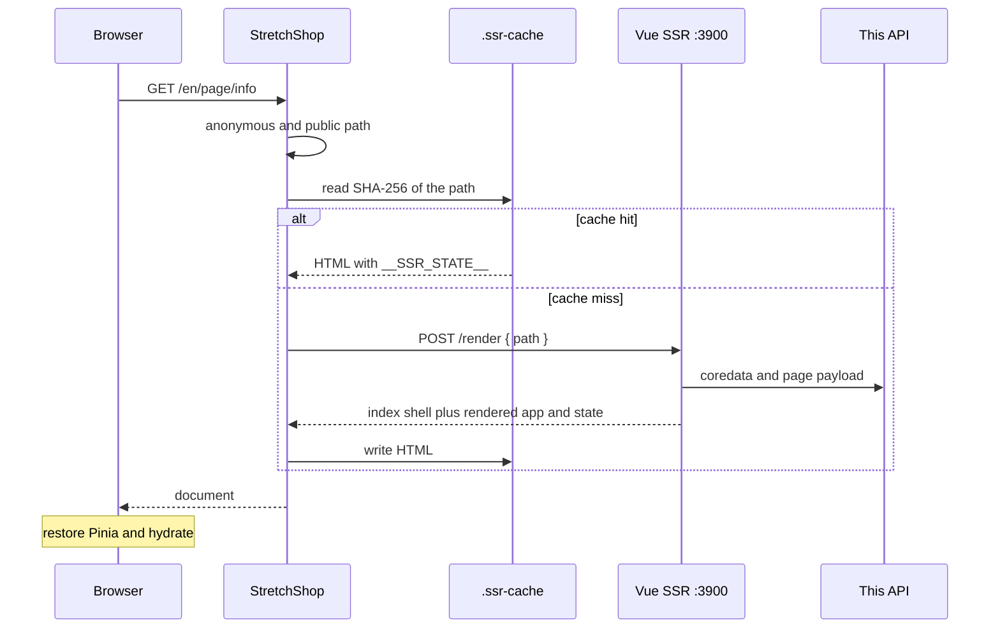

# Serving Vue SSR pages

Anonymous public pages can be served as HTML that the Vue app hydrates. StretchShop decides that per request, caches the document, and asks the renderer in [stretchshop-front-vue](https://github.com/StretchShop/stretchshop-front-vue) to fill a miss. The Vue render, the hydration boot, and the production build are documented in that repo at `docs/ssr.md`.

Cart, account, checkout, search, and editors stay a client-side app. So does any request that already sends a `token` or `admin_token` cookie. Anonymous `session` / `cart` / `csrf` cookies do not skip SSR.

Until `SSR_RENDER_URL` is set, every document is `public/index.html` and the browser renders the page itself.

## Request path



1. `services/api/api.service.js` stores the original path on the request (`__stretchshopPath`), then the history fallback rewrites extension-less URLs to `/index.html`.
2. Middleware after that rewrite calls `serveStorefrontHtml` (`services/api/ssr-html.js`). Aliases alone cannot do this: moleculer resolves them against the original URL (`/en`) before the rewrite, so a `/index.html` alias never runs for public pages.
3. Only locale-prefixed public paths are rendered (`/en`, `/en/page/…`, …). Bare `/` is not in that list, so it stays the client shell (or the SPA redirects to `/en`).

3. Server HTML is used when the URL has no query string, the cookie header has no login cookie, and `isPublicSsrPath` matches (`services/api/ssr-paths.js`).
4. `services/api/ssr-cache.js` reads `.ssr-cache/<sha256>.html`. Files older than `SSR_CACHE_TTL_MS` (default one hour) are removed. Files without `__SSR_STATE__` are ignored.
5. On a miss, the API `POST`s `{ "path": "/en/page/info" }` to `SSR_RENDER_URL` with `Authorization: Bearer <SSR_RENDER_SECRET>` when a secret is set. The wait is `SSR_RENDER_TIMEOUT_MS` (default 15 seconds).
6. A body that contains `id="app"` and `__SSR_STATE__` is stored and returned with `Cache-Control: private, no-cache` and `Vary: Cookie`.
7. Any other outcome sends `public/index.html`. The visitor still gets the shop.

The same allow-list lives in the frontend as `src/ssr/public-path.js`. Change both files together.

| Served from cache or the renderer | Client shell |
|-----------------------------------|--------------|
| `/en` | `/` |
| `/en/products`, `/en/services` | `/en/cart`, `/en/login`, `/en/user` |
| `/en/products/books`, `/en/pages/news` | paths ending in `/edit` |
| `/en/products/books/product/bookmark/abc` | any path with `?` |
| `/en/page/info`, `/en/pages/news/page/hello` | a request with `token` or `admin_token` |

## Cache invalidation

Page, product, and category saves and deletes set `ctx.meta.afterCallAction` to `{ type: "render", ... }`. After the route handler writes the response, `resources/routes/apiV1.js` calls `afterCallAction`, and `services/api/methods/core.methods.js` deletes the whole cache directory.

The wipe is global because the hook carries the API URL, and navigation and listings are shared across public pages. The next anonymous request renders that URL again.

## Production

The renderer is a second process. It is not inside this repo and it must not be published on the shop vhost. It reads its own `dist/index.html` as a template and returns HTML only. The browser then loads `/app/*` from this app's `public/`.

### 1. Build and publish the client

In `stretchshop-front-vue`:

```bash
npm ci
npm run build
```

`postbuild` copies `dist/` into this repo's `public/`. Confirm `public/index.html` still contains `<!--ssr-outlet-->`, `<!--ssr-state-->`, and a `/app/<hash>.js` script. `ssr-dist/` stays in the frontend checkout. That is what `npm run ssr` imports.

Rebuild the client and the server bundle in one `npm run build`. The template and the bundle have to match, and `public/app/` has to be that same client build.

### 2. Run the renderer where the API can reach it

The renderer lives in [stretchshop-front-vue](https://github.com/StretchShop/stretchshop-front-vue). On a host checkout:

```bash
export SSR_API_ORIGIN=http://127.0.0.1:3000
export SSR_RENDER_SECRET='replace-with-a-long-random-string'
export SSR_HOST=127.0.0.1
export PORT=3900
npm run ssr
```

Or build and run the frontend product `Dockerfile` on a private Docker network (`SSR_HOST` defaults to `0.0.0.0` in the image). That image is part of the paid frontend distribution — keep it private; it contains the compiled Vue app.

```bash
docker build -t stretchshop-ssr /path/to/stretchshop-front-vue
docker run --rm --name stretchshop-ssr --network stretchshop \
  -e SSR_API_ORIGIN=http://stretchshop:3000 \
  -e SSR_RENDER_SECRET='replace-with-a-long-random-string' \
  stretchshop-ssr
```

Keep the renderer off the public vhost. Run it under the same process manager or compose stack as the API and restart it on boot. Renders are serialized inside one process. Several renderer processes can sit behind one URL; each has its own memory.

```bash
curl -sS -o /dev/null -D - \
  -H "Authorization: Bearer $SSR_RENDER_SECRET" \
  -H 'content-type: application/json' \
  -d '{"path":"/en"}' \
  http://127.0.0.1:3900/render
```

`200` is a rendered home page. `204` means the renderer refused the path and the shop will send the client shell. `401` means the secret does not match.

### 3. Turn it on in this API

From `.env.example`:

```bash
SSR_RENDER_URL=http://127.0.0.1:3900/render
SSR_RENDER_SECRET='the-same-secret'
SSR_RENDER_TIMEOUT_MS=15000
# SSR_CACHE_DIR=
# SSR_CACHE_TTL_MS=3600000
```

| Variable | Default | Purpose |
|----------|---------|---------|
| `SSR_RENDER_URL` | unset, SSR off | Renderer endpoint |
| `SSR_RENDER_SECRET` | empty | Bearer token sent on each render |
| `SSR_RENDER_TIMEOUT_MS` | `15000` | Then send `index.html` |
| `SSR_CACHE_DIR` | `<cwd>/.ssr-cache` | HTML files. Gitignored |
| `SSR_CACHE_TTL_MS` | `3600000` | Max age before a file is rendered again |

Set `SSR_CACHE_DIR` when the process cwd is not the repo root. Every worker that serves HTML, and the worker that handles content saves, has to see this directory. On more than one machine, use a shared filesystem. Deleting the directory on one host leaves the other host's files in place.

Restart the API after changing these. In Docker, `SSR_RENDER_URL` must be an address the API container can open, and `SSR_API_ORIGIN` on the renderer must be an address that reaches this API.

### 4. Proxy

Send shop URLs without a file extension to this Node process so `serveStorefrontHtml` runs. Serve `/app/*` from `public/` as static files. Do not route the public site at the renderer.

### 5. Check

In a private window, open `/en` or `/en/page/info`.

- The source of `#app` contains the page, and the source contains `window.__SSR_STATE__`.
- The same URL with a `token` cookie is the empty shell.
- `/en/cart` is the empty shell.
- After you save a page, product, or category, the next anonymous load shows the new content. The API log includes `afterCallAction` with `type: "render"`.

If the renderer is down, slow, or returns 204, the response is still `index.html` and the browser fetches the page itself.

## Code

| File | Role |
|------|------|
| `services/api/ssr-html.js` | Cache, renderer, or client shell |
| `services/api/ssr-cache.js` | Files on disk and the HTTP call |
| `services/api/ssr-paths.js` | Public paths and login cookies |
| `services/api/api.service.js` | History fallback hands off to the helper |
| `services/api/methods/core.methods.js` | `type: "render"` deletes the cache |
| `resources/routes/apiV1.js` | Calls `afterCallAction` after a mapped route |

Tests: `npm test -- test/unit/services/ssr-cache.spec.js`.

## Troubleshooting

| What you see | What to check |
|--------------|----------------|
| Source is always the empty `#app` | `SSR_RENDER_URL`, then the renderer process |
| API log `ssr render request failed` | Secret, timeout, and whether `127.0.0.1:3900` is reachable from this process |
| Renderer `ECONNREFUSED` | `SSR_API_ORIGIN` from the renderer |
| New content stays old for up to an hour | The mutation did not set `type: "render"`, or this process cannot delete `SSR_CACHE_DIR` |
| HTML references a missing `/app/*.js` | `public/` is not the `dist/` from the same `npm run build` as `ssr-dist/` |
